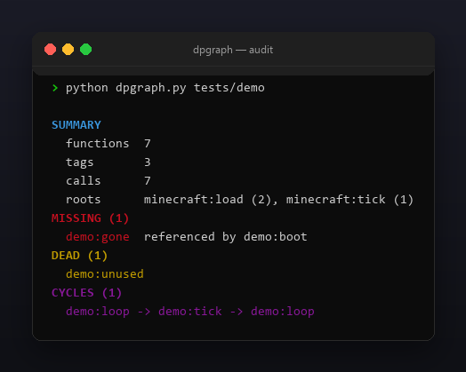
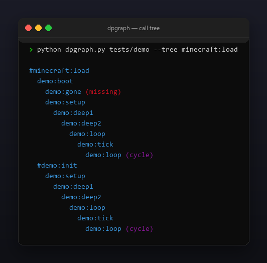

<p align="center"></p>

<p align="center">
  <a href="README.ru.md"></a>
  <a href="https://github.com/Celine1337/dpgraph/releases"></a>
  <a href="https://github.com/Celine1337/dpgraph/actions/workflows/ci.yml"></a>
  <a href="LICENSE"></a>
</p>


Static call-graph auditor for Minecraft datapacks. Point it at a datapack root
and it scans every `data/<ns>/function(s)/**/*.mcfunction`, builds the call
graph — including `function #tag` expansion and `minecraft:load` / `minecraft:tick`
roots — and tells you what is broken or unused:

- **missing** — called functions or tag values that have no file;
- **dead** — functions unreachable from any load/tick root;
- **cycles** — call loops (strongly connected components), including
  `schedule`-based recursion.

Single file, standard library only, Python 3.9+. No Minecraft installation,
no game launch — pure static analysis of your pack's sources.


- Parses plain `function ns:path`, `execute ... run function ...` and
  `schedule function ns:path 5t`; full-line `#` comments are ignored.
- Tag support: `function #ns:tag`, nested tag values (`"#ns:other"`),
  `{"id": ..., "required": false}` optional entries are not flagged missing.
- Both directory layouts: `function/` (1.21+) and legacy `functions/`.
- Roots from `minecraft:load` and `minecraft:tick`; reachability over the
  whole graph, cycles via iterative Kosaraju SCC (no recursion limits).
- `--tree ns:id` prints an indented call tree with `(cycle)` / `(missing)` marks.
- `--json` machine-readable report; exit code `1` when issues are found, so it
  works as a CI gate for your datapack repository.
- Colored ANSI output, `--no-color` and `NO_COLOR`.


```console
$ python dpgraph.py path/to/datapack
$ python dpgraph.py path/to/datapack --tree minecraft:load
$ python dpgraph.py path/to/datapack --json
```

```
SUMMARY
  functions  7
  tags       3
  calls      7
  roots      minecraft:load (2), minecraft:tick (1)
MISSING (1)
  demo:gone  referenced by demo:boot
DEAD (1)
  demo:unused
CYCLES (1)
  demo:loop -> demo:tick -> demo:loop
```

Exit codes: `0` — clean, `1` — missing/dead/cycles found, `2` — bad path or
unreadable pack. A `schedule` loop is a common intentional pattern (tick
chains); dpgraph reports it, you decide whether it is a bug.

Limits, on purpose: only `function` calls are edges — calls hidden in macros,
advancement rewards or command blocks inside structures are not tracked;
one datapack per run.







```console
$ python -m unittest discover -s tests -v
```

17 tests cover scanning (both layouts, comments, execute/schedule, tag syntax),
reachability, optional tag values, cycles, tree marks, JSON and exit codes.
The demo pack and all images are regenerable:

```console
$ python tools/make_demo.py       # tests/demo with one of each issue
$ pip install pillow
$ python tools/make_shots.py      # docs/audit.png, docs/tree.png
$ python tools/make_style.py tools/style.json docs/style
```


[MIT](LICENSE) © Celine1337