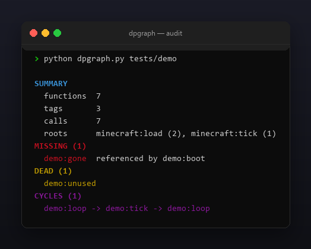
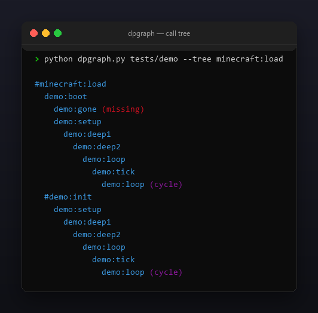

<p align="center"></p>

<p align="center">
  <a href="README.md"></a>
  <a href="https://github.com/Celine1337/dpgraph/releases"></a>
  <a href="https://github.com/Celine1337/dpgraph/actions/workflows/ci.yml"></a>
  <a href="LICENSE"></a>
</p>


Статический аудитор графа вызовов для Minecraft-датапаков. Указываешь корень
датапака — он сканирует все `data/<ns>/function(s)/**/*.mcfunction`, строит граф
вызовов (включая раскрытие `function #tag` и корни `minecraft:load` /
`minecraft:tick`) и показывает, что сломано или не используется:

- **missing** — вызываемые функции и значения тегов, у которых нет файла;
- **dead** — функции, недостижимые ни из одного load/tick-корня;
- **cycles** — петли вызовов (сильно связные компоненты), включая
  рекурсию через `schedule`.

Один файл, только стандартная библиотека, Python 3.9+. Ни установки Minecraft,
ни запуска игры — чистый статический анализ исходников пака.


- Парсит обычные `function ns:path`, `execute ... run function ...` и
  `schedule function ns:path 5t`; строки-комментарии `#` игнорируются.
- Теги: `function #ns:tag`, вложенные значения тегов (`"#ns:other"`),
  опциональные записи `{"id": ..., "required": false}` не флагуются как missing.
- Обе раскладки каталогов: `function/` (1.21+) и легаси `functions/`.
- Корни из `minecraft:load` и `minecraft:tick`; достижимость по всему графу,
  циклы через итеративный Косарайю (без лимитов рекурсии).
- `--tree ns:id` печатает дерево вызовов с пометками `(cycle)` / `(missing)`.
- `--json` — машиночитаемый отчёт; код возврата `1` при найденных проблемах,
  так что утилита работает как CI-гейт для репозитория датапака.
- Цветной ANSI-вывод, `--no-color` и `NO_COLOR`.


```console
$ python dpgraph.py path/to/datapack
$ python dpgraph.py path/to/datapack --tree minecraft:load
$ python dpgraph.py path/to/datapack --json
```

```
SUMMARY
  functions  7
  tags       3
  calls      7
  roots      minecraft:load (2), minecraft:tick (1)
MISSING (1)
  demo:gone  referenced by demo:boot
DEAD (1)
  demo:unused
CYCLES (1)
  demo:loop -> demo:tick -> demo:loop
```

Коды возврата: `0` — чисто, `1` — найдены missing/dead/cycles, `2` — неверный
путь или нечитаемый пак. Петля через `schedule` — частый намеренный паттерн
(tick-цепочки); dpgraph её показывает, а баг это или нет — решаешь ты.

Ограничения сознательные: рёбра только из вызовов `function` — вызовы, спрятанные
в макросах, наградах достижений или командных блоках внутри структур, не
учитываются; один датапак за запуск.







```console
$ python -m unittest discover -s tests -v
```

17 тестов: сканирование (обе раскладки, комментарии, execute/schedule, синтаксис
тегов), достижимость, опциональные значения тегов, циклы, пометки дерева, JSON
и коды возврата. Демо-пак и все картинки пересобираются:

```console
$ python tools/make_demo.py       # tests/demo с одной проблемой каждого вида
$ pip install pillow
$ python tools/make_shots.py      # docs/audit.png, docs/tree.png
$ python tools/make_style.py tools/style.json docs/style
```


[MIT](LICENSE) © Celine1337